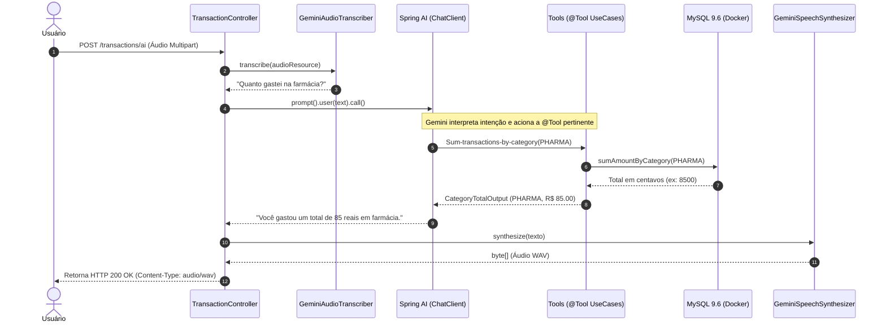

# Budgeting - Assistente Financeiro Inteligente por Voz e REST

[](https://www.oracle.com/java/)
[](https://spring.io/projects/spring-boot)
[](https://spring.io/projects/spring-ai)
[](https://ai.google.dev/)
[](https://www.mysql.com/)
[]()
[](target/site/jacoco/index.html)

API de controle financeiro e orçamento pessoal que une endpoints REST tradicionais a um assistente inteligente multimodal de IA generativa (Google Gemini via Spring AI). O sistema elimina a fricção no registro manual de transações cotidianas, permitindo ao usuário registrar despesas, listar extratos e consultar o total acumulado de gastos por categoria através de comandos de voz em linguagem natural, recebendo como retorno uma resposta sintetizada em áudio falado e mantendo os dados persistidos de forma estruturada em banco relacional.

---

## 📌 Índice

- [Funcionalidades](#-funcionalidades)
- [Arquitetura e Fluxo do Sistema](#-arquitetura-e-fluxo-do-sistema)
  - [Fluxo de Execução com IA Multimodal](#fluxo-de-execução-com-ia-multimodal)
  - [Estrutura de Pastas](#estrutura-de-pastas)
- [Ferramentas de IA (Function Calling / Tools)](#-ferramentas-de-ia-function-calling--tools)
- [Pré-requisitos e Configuração](#-pré-requisitos-e-configuração)
  - [Requisitos Mínimos](#requisitos-mínimos)
  - [Variáveis de Ambiente (.env)](#variáveis-de-ambiente-env)
- [Como Executar o Projeto](#-como-executar-o-projeto)
  - [1. Clonar o Repositório](#1-clonar-o-repositório)
  - [2. Iniciar o Banco de Dados com Docker](#2-iniciar-o-banco-de-dados-com-docker)
  - [3. Executar o Aplicativo](#3-executar-o-aplicativo)
  - [4. Build para Produção](#4-build-para-produção)
- [Testes Automatizados e Cobertura](#-testes-automatizados-e-cobertura)
- [Rotas / API Endpoints](#-rotas--api-endpoints)
  - [Exemplos de Uso e cURL](#exemplos-de-uso-e-curl)
- [Tecnologias Utilizadas](#-tecnologias-utilizadas)
- [Licença](#-licença)

---

## 🚀 Funcionalidades

- **Gerenciamento REST Tradicional de Transações:**
  - Cadastro de despesas com descrição, categoria (`GROCERIES`, `PHARMA`, `AUTO`) e valor em centavos inteiros (`long amount`) para evitar imprecisões de arredondamento em ponto flutuante. Resposta HTTP 201 Created com valor monetário formatado com precisão em `BigDecimal`.
  - Consulta do histórico de lançamentos filtrada por categoria no path da URL (`GET /transactions/{category}`).

- **Assistente Financeiro Multimodal por Voz (`POST /transactions/ai`):**
  - **Detecção Dinâmica e Transcrição de Áudio (STT):** Recebe o arquivo de áudio via upload multipart/form-data com detecção automática do tipo MIME via `MediaTypeFactory` (suporte a WAV, MP3, OGG, WebM, etc.) e utiliza o modelo `gemini-3.5-flash` do Google GenAI para conversão precisa de fala em texto.
  - **Raciocínio e Function Calling com Spring AI:** Orquestração do comando textual via `ChatClient` com injeção de prompt de sistema (`system-message.st`), permitindo ao Gemini identificar a intenção do usuário e acionar de forma autônoma as ferramentas de negócio da aplicação.
  - **Totalização de Gastos:** Capacidade de calcular a soma acumulada de despesas por categoria através da nova ferramenta `Sum-transactions-by-category`, respondendo perguntas diretas como *"Quanto gastei em farmácia?"*.
  - **Síntese de Fala (TTS):** Geração de resposta sintetizada em áudio WAV com entonação natural utilizando o modelo `gemini-3.8-flash-lite-tts` com a voz `Kore`, retornando com cabeçalho `Content-Type: audio/wav`.

---

## 🏗️ Arquitetura e Fluxo do Sistema

O projeto adota os princípios da **Arquitetura Hexagonal (Ports & Adapters)** combinados com **Clean Architecture** e conceitos de **Domain-Driven Design (DDD)**:

- **Camada de Domínio (`domain`):** Núcleo desacoplado de frameworks externos. Contém a entidade `Transaction`, o Value Object `TransactionId` (encapsulando `UUID`), o enum de categorias `Category` e a porta secundária `TransactionRepository`.
- **Camada de Aplicação (`application`):** Implementa os casos de uso do negócio (`PersistTransactionUseCase`, `ListTransactionsByCategoryUseCase`, `SumTransactionsByCategoryUseCase`, `TranscribeAudioUseCase`, `SpeechSynthesizerUseCase`), as portas secundárias de IA (`AudioTranscriber`, `SpeechSynthesizer`) e os DTOs imutáveis (Records: `PersistTransactionInput`, `TransactionOutput`, `CategoryTotalOutput`, `SpeechOutput`).
- **Camada de Infraestrutura (`infrastructure`):** Implementa os adaptadores de entrada e saída:
  - *Adaptador HTTP (`http`):* `TransactionController` expondo as rotas REST e gerenciando requisições multipart, além dos DTOs `TransactionRequest` e `TransactionResponse`.
  - *Adaptadores de IA (`gemini`):* `GeminiAudioTranscriber` (Spring AI Google GenAI) e `GeminiSpeechSynthesizer` (SDK oficial `com.google.genai.Client`).
  - *Adaptador de Persistência (`persistence`):* `TransactionEntity`, `TransactionEntityRepository` (Spring Data CrudRepository com JPQL otimizada) e `JpaTransactionRepository` (implementação de `TransactionRepository`).

### Fluxo de Execução com IA Multimodal



> [!NOTE]
> O mesmo fluxo multimodal se aplica ao registro de gastos (*"Gastei 50 reais no mercado com carnes"*, acionando `Persist-transaction`) e à consulta detalhada de lançamentos (*"Liste meus gastos com carro"*, acionando `List-transaction-by-category`).

### Estrutura de Pastas

```text
ProjetoBudgetingItauEDio/
├── compose.yml                               # Configuração do MySQL 9.6 via Docker Compose
├── pom.xml                                   # POM Maven: Spring Boot 4.0.8, Spring AI 2.0.1 e JaCoCo
├── mvnw / mvnw.cmd                           # Maven Wrapper para Linux, macOS e Windows
├── .envexemple                               # Modelo de variáveis de ambiente do projeto
├── src/
│   ├── main/
│   │   ├── java/br/com/ItauDIO/Budgeting/
│   │   │   ├── BudgetingApplication.java     # Entry point Spring Boot e inicialização do contexto
│   │   │   ├── application/                  # Camada de Aplicação (Casos de Uso e Portas)
│   │   │   │   ├── PersistTransactionUseCase.java          # Ferramenta @Tool: persistência
│   │   │   │   ├── ListTransactionsByCategoryUseCase.java   # Ferramenta @Tool: listagem
│   │   │   │   ├── SumTransactionsByCategoryUseCase.java    # Ferramenta @Tool: totalização
│   │   │   │   ├── TranscribeAudioUseCase.java             # Caso de uso: transcrição STT
│   │   │   │   ├── SpeechSynthesizerUseCase.java           # Caso de uso: síntese TTS
│   │   │   │   ├── input/
│   │   │   │   │   └── PersistTransactionInput.java
│   │   │   │   ├── output/
│   │   │   │   │   ├── CategoryTotalOutput.java            # DTO com total agregado formatado
│   │   │   │   │   ├── SpeechOutput.java
│   │   │   │   │   └── TransactionOutput.java
│   │   │   │   └── port/
│   │   │   │       ├── AudioTranscriber.java               # Porta secundária de transcrição
│   │   │   │       └── SpeechSynthesizer.java              # Porta secundária de síntese de voz
│   │   │   ├── domain/                       # Camada de Domínio (Entidades e Regras de Negócio)
│   │   │   │   ├── Category.java             # Enum: GROCERIES, PHARMA, AUTO
│   │   │   │   ├── Transaction.java          # Entidade de domínio rica
│   │   │   │   ├── TransactionId.java        # Value Object encapsulando UUID
│   │   │   │   └── TransactionRepository.java # Porta de persistência de dados
│   │   │   └── infrastructure/               # Camada de Infraestrutura (Adaptadores)
│   │   │       ├── gemini/                   # Adaptadores de integração com o Google GenAI
│   │   │       │   ├── GeminiAudioTranscriber.java
│   │   │       │   └── GeminiSpeechSynthesizer.java
│   │   │       ├── http/                     # Adaptadores de transporte HTTP REST
│   │   │       │   ├── TransactionController.java
│   │   │       │   ├── request/
│   │   │       │   │   └── TransactionRequest.java
│   │   │       │   └── response/
│   │   │       │       └── TransactionResponse.java
│   │   │       └── persistence/              # Adaptadores de persistência relacional
│   │   │           ├── entity/
│   │   │           │   └── TransactionEntity.java
│   │   │           └── repository/
│   │   │               ├── JpaTransactionRepository.java
│   │   │               └── TransactionEntityRepository.java
│   │   └── resources/
│   │       ├── application.yaml              # Parâmetros da aplicação, conexão e modelos Gemini
│   │       └── prompts/
│   │           └── system-message.st         # Template de prompt de sistema para o ChatClient
│   └── test/
│       └── java/br/com/ItauDIO/Budgeting/    # 32 testes unitários (JUnit 5 e Mockito)
│           ├── application/
│           ├── domain/
│           └── infrastructure/
```

---

## 🤖 Ferramentas de IA (Function Calling / Tools)

O assistente orquestrado pelo Spring AI conta com três ferramentas de negócio declaradas com a anotação `@Tool`. O modelo `gemini-3.5-flash` seleciona e invoca a ferramenta adequada em tempo de execução com base no comando falado:

| Nome da Ferramenta (`@Tool`) | Classe / Caso de Uso | Parâmetros de Entrada | Saída / Retorno | Descrição |
|------------------------------|----------------------|-----------------------|-----------------|-----------|
| `Persist-transaction` | `PersistTransactionUseCase` | `PersistTransactionInput`<br>- `description` (String)<br>- `category` (Category)<br>- `amount` (long em centavos) | `TransactionOutput`<br>- `id` (String)<br>- `description` (String)<br>- `category` (String)<br>- `value` (BigDecimal) | Persiste uma nova transação financeira na categoria mais apropriada inferred pelo modelo. |
| `List-transaction-by-category` | `ListTransactionsByCategoryUseCase` | `category` (Category:<br>`GROCERIES`, `PHARMA`, `AUTO`) | `List<TransactionOutput>` | Retorna a lista detalhada de transações cadastradas sob uma determinada categoria. |
| `Sum-transactions-by-category` | `SumTransactionsByCategoryUseCase` | `category` (Category:<br>`GROCERIES`, `PHARMA`, `AUTO`) | `CategoryTotalOutput`<br>- `category` (String)<br>- `total` (BigDecimal) | Calcula o valor total acumulado gasto em uma categoria via query JPQL otimizada no banco. |

---

## ⚙️ Pré-requisitos e Configuração

### Requisitos Mínimos
- **Java JDK 21** ou superior instalado e configurado no `PATH`.
- **Docker e Docker Compose** instalados (para execução do banco de dados MySQL).
- **Chave de API do Google AI Studio** válida ([Obtenha sua chave gratuitamente](https://aistudio.google.com/)).

### Variáveis de Ambiente (`.env`)

Crie um arquivo `.env` na raiz do projeto (utilize o [.envexemple](.envexemple) como referência):

```env
# Configurações do Banco de Dados MySQL
MYSQL_DATABASE=transaction
MYSQL_ROOT_PASSWORD=sua_senha_root_aqui
MYSQL_USER=seu_usuario_aqui
MYSQL_PASSWORD=sua_senha_usuario_aqui

# Chave de API para o Google GenAI / Gemini
GOOGLE_API_KEY=sua_chave_do_google_ai_aqui
```

> [!NOTE]
> O Spring Boot importa automaticamente as variáveis declaradas no arquivo `.env` na inicialização através da configuração `spring.config.import=optional:file:.env[.properties]` definida em [application.yaml](src/main/resources/application.yaml).

---

## 💻 Como Executar o Projeto

### 1. Clonar o Repositório
```bash
git clone https://github.com/GLzanetti/ProjetoBudgetingItauEDio.git
cd ProjetoBudgetingItauEDio
```

### 2. Iniciar o Banco de Dados com Docker
Suba o container do MySQL 9.6 em segundo plano:
```bash
docker compose up -d
```
> O container expõe a porta `3307` no host mapeada para a porta interna `3306` do MySQL.

### 3. Executar o Aplicativo

**No Linux ou macOS:**
```bash
./mvnw spring-boot:run
```

**No Windows (PowerShell / CMD):**
```bash
.\mvnw.cmd spring-boot:run
```

A aplicação iniciará na porta padrão `8080` (`http://localhost:8080`).

### 4. Build para Produção

**No Linux ou macOS:**
```bash
./mvnw clean package -DskipTests
java -jar target/Budgeting-0.0.1-SNAPSHOT.jar
```

**No Windows (PowerShell):**
```bash
.\mvnw.cmd clean package -DskipTests
java -jar target/Budgeting-0.0.1-SNAPSHOT.jar
```

---

## 🧪 Testes Automatizados e Cobertura

O projeto possui **32 testes unitários** automatizados cobrindo as camadas de domínio, aplicação e adaptadores de infraestrutura, utilizando **JUnit 5** e **Mockito** para isolamento completo sem dependências externas.

### Executar a Suíte de Testes

**No Linux ou macOS:**
```bash
./mvnw test
```

**No Windows (PowerShell / CMD):**
```bash
.\mvnw.cmd test
```

### Distribuição dos Testes por Camada

| Camada | Classe de Teste | Qtd. Testes | Status |
|--------|-----------------|:-----------:|:------:|
| **Application** | `ListTransactionsByCategoryUseCaseTest` | 3 | ✅ Passou |
| **Application** | `PersistTransactionUseCaseTest` | 2 | ✅ Passou |
| **Application** | `SpeechSynthesizerUseCaseTest` | 2 | ✅ Passou |
| **Application** | `SumTransactionsByCategoryUseCaseTest` | 3 | ✅ Passou |
| **Application** | `TranscribeAudioUseCaseTest` | 2 | ✅ Passou |
| **Domain** | `TransactionIdTest` | 3 | ✅ Passou |
| **Domain** | `TransactionTest` | 7 | ✅ Passou |
| **Infrastructure** | `TransactionControllerTest` (MockMvc) | 4 | ✅ Passou |
| **Infrastructure** | `JpaTransactionRepositoryTest` | 5 | ✅ Passou |
| **Infrastructure** | `TransactionEntityTest` | 1 | ✅ Passou |
| **Total** | **10 classes de teste** | **32** | **100% Sucesso** |

### Relatório de Cobertura (JaCoCo)
A geração do relatório JaCoCo está atrelada ao ciclo de testes do Maven (`jacoco-maven-plugin` 0.8.12). Após rodar `mvn test`, o relatório HTML interativo estará disponível em:
```text
target/site/jacoco/index.html
```

---

## 📜 Rotas / API Endpoints

Abaixo estão os endpoints REST públicos expostos pelo sistema na rota `/transactions`:

| Método | Endpoint | Parâmetros / Formato | Descrição |
|--------|----------|----------------------|-----------|
| `POST` | `/transactions` | `Body` (`application/json`):<br>`{ "description": String, "category": Category, "amount": long }` | Cadastra manualmente uma nova despesa informando o valor `amount` em centavos inteiros. Retorna HTTP 201 Created com valor formatado em `BigDecimal`. |
| `GET` | `/transactions/{category}` | `Path`: `category` (`GROCERIES`, `PHARMA`, `AUTO`) | Retorna a listagem de todas as transações cadastradas na categoria especificada. Retorna HTTP 200 OK. |
| `POST` | `/transactions/ai` | `Multipart`: `file` (arquivo de áudio em formato suportado) | Processa comando por voz: transcreve (STT), raciocina e executa Function Calling via Spring AI, sintetiza a fala (TTS) e devolve a resposta em áudio falado (`audio/wav`). |

### Exemplos de Uso e cURL

#### 1. Cadastrar Transação Manualmente (`POST /transactions`)
- **Requisição:**
  ```bash
  curl -X POST "http://localhost:8080/transactions" \
    -H "Content-Type: application/json" \
    -d '{
      "description": "Supermercado Semanal",
      "category": "GROCERIES",
      "amount": 15450
    }'
  ```
- **Resposta (HTTP 201 Created):**
  ```json
  {
    "id": "e4b2d184-7ef2-4f35-9d32-261c142b93e1",
    "category": "GROCERIES",
    "description": "Supermercado Semanal",
    "amount": 154.50
  }
  ```

#### 2. Consultar Transações por Categoria (`GET /transactions/{category}`)
- **Requisição:**
  ```bash
  curl -X GET "http://localhost:8080/transactions/GROCERIES" \
    -H "Accept: application/json"
  ```
- **Resposta (HTTP 200 OK):**
  ```json
  [
    {
      "id": "e4b2d184-7ef2-4f35-9d32-261c142b93e1",
      "category": "GROCERIES",
      "description": "Supermercado Semanal",
      "amount": 154.50
    }
  ]
  ```

#### 3. Assistente Financeiro por Voz (`POST /transactions/ai`)
Envie um comando gravado (ex.: *"Quanto gastei na farmácia?"* ou *"Gastei 45 reais na farmácia com remédios"*):
- **Requisição:**
  ```bash
  curl -X POST "http://localhost:8080/transactions/ai" \
    -H "Accept: audio/wav" \
    -H "Content-Type: multipart/form-data" \
    -F "file=@audio_pergunta.wav" \
    --output resposta_assistente.wav
  ```
- **Resposta:**
  Arquivo de áudio binário (`audio/wav`) contendo a resposta falada sintetizada pelo Google Gemini (ex.: *"Você gastou um total de 45 reais em farmácia."*).

---

## 🛠️ Tecnologias Utilizadas

- **[Java 21](https://www.oracle.com/java/)** — Versão LTS da plataforma Java com Virtual Threads e Pattern Matching.
- **[Spring Boot 4.0.8](https://spring.io/projects/spring-boot)** — Framework fundamental para criação da API REST e injeção de dependências.
- **[Spring AI 2.0.1](https://spring.io/projects/spring-ai)** — Framework de orquestração de IA, Function Calling (`@Tool`) e clientes de modelos generativos.
- **[Google GenAI SDK](https://github.com/google-gemini/generative-ai-java)** — Modelos `gemini-3.5-flash` (transcrição STT e chat) e `gemini-3.8-flash-lite-tts` (síntese de áudio TTS).
- **[Spring Data JPA & Hibernate](https://spring.io/projects/spring-data-jpa)** — Mapeamento objeto-relacional (ORM) e consultas agregadas JPQL.
- **[MySQL 9.6](https://www.mysql.com/)** — Banco de dados relacional para persistência de dados.
- **[Docker & Docker Compose](https://www.docker.com/)** — Conteinerização ágil da infraestrutura de dados local.
- **[JUnit 5](https://junit.org/junit5/) & [Mockito](https://site.mockito.org/)** — Testes automatizados unitários e de integração mockada.
- **[JaCoCo 0.8.12](https://www.jacoco.org/jacoco/)** — Instrumentação e auditoria de cobertura de testes.
- **[Project Lombok](https://projectlombok.org/)** — Produtividade no código eliminando construtores e getters repetitivos.

---

## 📄 Licença

Este projeto foi desenvolvido como parte do programa de formação **DIO com Itaú (Java e IA)**.
Consulte o repositório para detalhes sobre direitos e termos de uso.
