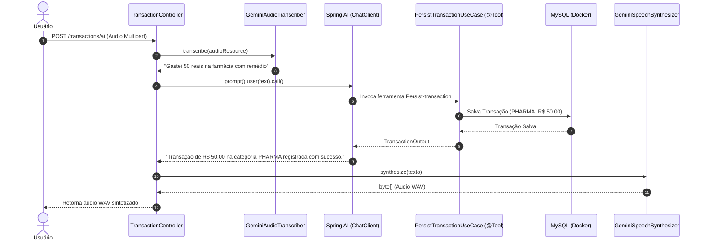

# Budgeting - Assistente Financeiro Inteligente por Voz e REST

[](https://www.oracle.com/java/)
[](https://spring.io/projects/spring-boot)
[](https://spring.io/projects/spring-ai)
[](https://ai.google.dev/)
[](https://www.mysql.com/)

API de controle financeiro e orçamento pessoal que une endpoints REST com inteligência artificial multimodal. O sistema permite registrar transações e consultar despesas por comandos de voz, realizando transcrição de áudio (STT), interpretação com Function Calling (Tool Calling) via Spring AI e resposta sintetizada em áudio falado (TTS) com o Google Gemini.

---

## 📌 Índice

- [Funcionalidades](#-funcionalidades)
- [Arquitetura e Estrutura do Projeto](#-arquitetura-e-estrutura-do-projeto)
- [Pré-requisitos e Configuração](#-pré-requisitos-e-configuração)
- [Como Executar o Projeto](#-como-executar-o-projeto)
- [Rotas / API Endpoints](#-rotas--api-endpoints)
- [Tecnologias Utilizadas](#-tecnologias-utilizadas)
- [Licença](#-licença)

---

## 🚀 Funcionalidades

Abaixo estão listadas as principais funcionalidades que este sistema disponibiliza:

- **Gerenciamento REST de Transações:** Cadastro manual de novas despesas informando valor, descrição e categoria (`GROCERIES`, `PHARMA`, `AUTO`).
- **Consulta Filtrada por Categoria:** Endpoint dedicado para listagem de gastos agrupados por categoria.
- **Assistente Financeiro Multimodal por Voz (`POST /transactions/ai`):**
  - **Transcrição de Áudio (STT):** Recebe o arquivo de áudio enviado pelo usuário e utiliza o modelo `gemini-3.5-flash` para converter fielmente a fala em texto.
  - **Interpretação e Execução de Ferramentas (Tool Calling):** O agente orquestrado pelo `ChatClient` do Spring AI processa o contexto da fala e aciona autonomamente as ferramentas internas da aplicação:
    - `Persist-transaction`: Cria e persiste uma transação na categoria mais apropriada.
    - `List-transaction-by-category`: Consulta e totaliza lançamentos de uma categoria solicitada.
  - **Síntese de Voz (TTS):** Transforma a resposta textual gerada pelo assistente em áudio WAV de resposta utilizando o modelo `gemini-3.8-flash-lite-tts` com a voz `Kore`.

---

## 🏗️ Arquitetura e Estrutura do Projeto

O projeto adota os princípios da **Arquitetura Hexagonal (Ports & Adapters)** com **Clean Architecture** e **DDD**, garantindo que as regras de negócio de orçamento permaneçam isoladas de bibliotecas externas e detalhes de infraestrutura.

### Fluxo de Execução com IA



### Estrutura de Pastas

```text
Budgeting/
├── compose.yml                               # Definição do serviço MySQL 9.6 para Docker Compose
├── pom.xml                                   # Configurações do Maven, Spring Boot 4.0.8 e Spring AI 2.0.1
├── mvnw / mvnw.cmd                           # Maven Wrapper (Linux / Windows)
├── src/
│   ├── main/
│   │   ├── java/br/com/ItauDIO/Budgeting/
│   │   │   ├── BudgetingApplication.java     # Entry point do Spring Boot e configuração do ChatClient
│   │   │   ├── application/                  # Casos de uso e portas de entrada/saída (Application Layer)
│   │   │   │   ├── PersistTransactionUseCase.java          # Ferramenta @Tool de persistência
│   │   │   │   ├── ListTransactionsByCategoryUseCase.java   # Ferramenta @Tool de consulta
│   │   │   │   ├── TranscribeAudioUseCase.java
│   │   │   │   ├── SpeechSynthesizerUseCase.java
│   │   │   │   ├── port/                     # Portas (AudioTranscriber, SpeechSynthesizer)
│   │   │   │   ├── input/                    # DTOs de entrada do caso de uso
│   │   │   │   └── output/                   # DTOs de saída do caso de uso
│   │   │   ├── domain/                       # Núcleo de domínio (Domain Layer)
│   │   │   │   ├── Category.java             # Enum: GROCERIES, PHARMA, AUTO
│   │   │   │   ├── Transaction.java          # Entidade de domínio
│   │   │   │   ├── TransactionId.java        # Value Object de identificador
│   │   │   │   └── TransactionRepository.java # Interface do repositório
│   │   │   └── infrastructure/               # Adaptadores técnicos (Infrastructure Layer)
│   │   │       ├── gemini/                   # Adaptadores de integração com Google GenAI (STT / TTS)
│   │   │       ├── http/                     # Controller REST e DTOs de Request / Response
│   │   │       └── persistence/              # Implementação JPA e repositório Spring Data
│   │   └── resources/
│   │       ├── application.yaml              # Configuração da aplicação, JPA e parâmetros do Gemini
│   │       └── prompts/
│   │           └── system-message.st         # Template do prompt de sistema do assistente
│   └── test/                                 # Testes automatizados
```

---

## ⚙️ Pré-requisitos e Configuração

### Requisitos Mínimos
- **Java JDK 21** ou superior instalado.
- **Docker e Docker Compose** (para subir a instância local do MySQL).
- **Chave de API do Google AI Studio** ([Obtenha sua chave aqui](https://aistudio.google.com/)).

### Variáveis de Ambiente (`.env`)

Crie um arquivo `.env` na raiz do projeto contendo as seguintes credenciais:

```env
# Chave de API para o Google GenAI / Gemini
GOOGLE_API_KEY=sua_chave_do_google_ai_aqui

# Configurações do Banco de Dados MySQL
MYSQL_DATABASE=budgeting_db
MYSQL_ROOT_PASSWORD=rootpassword
MYSQL_USER=budget_user
MYSQL_PASSWORD=budget_password
```

> [!NOTE]
> O arquivo `application.yaml` importa opcionalmente o `.env` via `spring.config.import=optional:file:.env[.properties]`.

---

## 💻 Como Executar o Projeto

Siga os passos abaixo para configurar e executar a aplicação em seu ambiente local.

### 1. Clonar o Repositório
```bash
git clone https://github.com/GLzanetti/ProjetoBudgetingItauEDio.git
cd ProjetoDIOeIta-
```

### 2. Iniciar o Banco de Dados com Docker
Suba o container do MySQL 9.6:
```bash
docker compose up -d
```
> O container expõe a porta `3307` no host mapeada para a porta interna `3306`.

### 3. Executar o Aplicativo

**No Linux/macOS:**
```bash
./mvnw spring-boot:run
```

**No Windows (PowerShell/CMD):**
```bash
.\mvnw.cmd spring-boot:run
```

A aplicação iniciará na porta padrão `8080`.

### 4. Build para Produção
```bash
./mvnw clean package -DskipTests
java -jar target/Budgeting-0.0.1-SNAPSHOT.jar
```

### 🧪 Executando os Testes
```bash
./mvnw test
```

---

## 📜 Rotas / API Endpoints

Abaixo estão mapeadas as principais rotas públicas expostas pelo sistema:

| Método | Endpoint | Parâmetros / Content-Type | Descrição |
|--------|----------|---------------------------|-----------|
| `POST` | `/transactions` | `application/json`<br>`{ "description": "Supermercado", "category": "GROCERIES", "amount": 120 }` | Cadastra manualmente uma nova transação financeira. |
| `GET` | `/transactions/{category}` | `Path`: `category` (`GROCERIES`, `PHARMA`, `AUTO`) | Retorna todas as transações cadastradas na categoria informada. |
| `POST` | `/transactions/ai` | `multipart/form-data`<br>Parâmetro: `file` (arquivo de áudio) | Recebe comando de voz, transcreve com Gemini, executa Tool Calling e retorna áudio falado (`audio/wav`). |

### Exemplo de Uso via cURL (Assistente por Áudio)

```bash
curl -X POST "http://localhost:8080/transactions/ai" \
  -H "accept: audio/wav" \
  -H "Content-Type: multipart/form-data" \
  -F "file=@gravacao_despesa.wav" \
  --output resposta.wav
```

---

## 🛠️ Tecnologias Utilizadas

Este projeto foi construído utilizando as seguintes tecnologias:

- **[Java 21](https://www.oracle.com/java/)** — Linguagem moderna com suporte aos recursos mais recentes.
- **[Spring Boot 4.0.8](https://spring.io/projects/spring-boot)** — Framework base para construção da API REST.
- **[Spring AI 2.0.1](https://spring.io/projects/spring-ai)** — Abstração de integração com modelos de IA e Function/Tool Calling.
- **[Google GenAI SDK](https://github.com/google-gemini/generative-ai-java)** — Comunicação direta com a API do Google Gemini (`gemini-3.5-flash` e `gemini-3.8-flash-lite-tts`).
- **[Spring Data JPA & Hibernate](https://spring.io/projects/spring-data-jpa)** — Mapeamento objeto-relacional e persistência de dados.
- **[MySQL 9.6](https://www.mysql.com/) & Docker Compose** — Banco de dados relacional conteinerizado.
- **[Lombok](https://projectlombok.org/)** — Redução de código repetitivo através de anotações.

---

## 📄 Licença

Este projeto foi desenvolvido como parte do programa de formação **DIO com Itaú (Java e IA)**. Consulte o repositório para detalhes sobre direitos e termos de uso.
