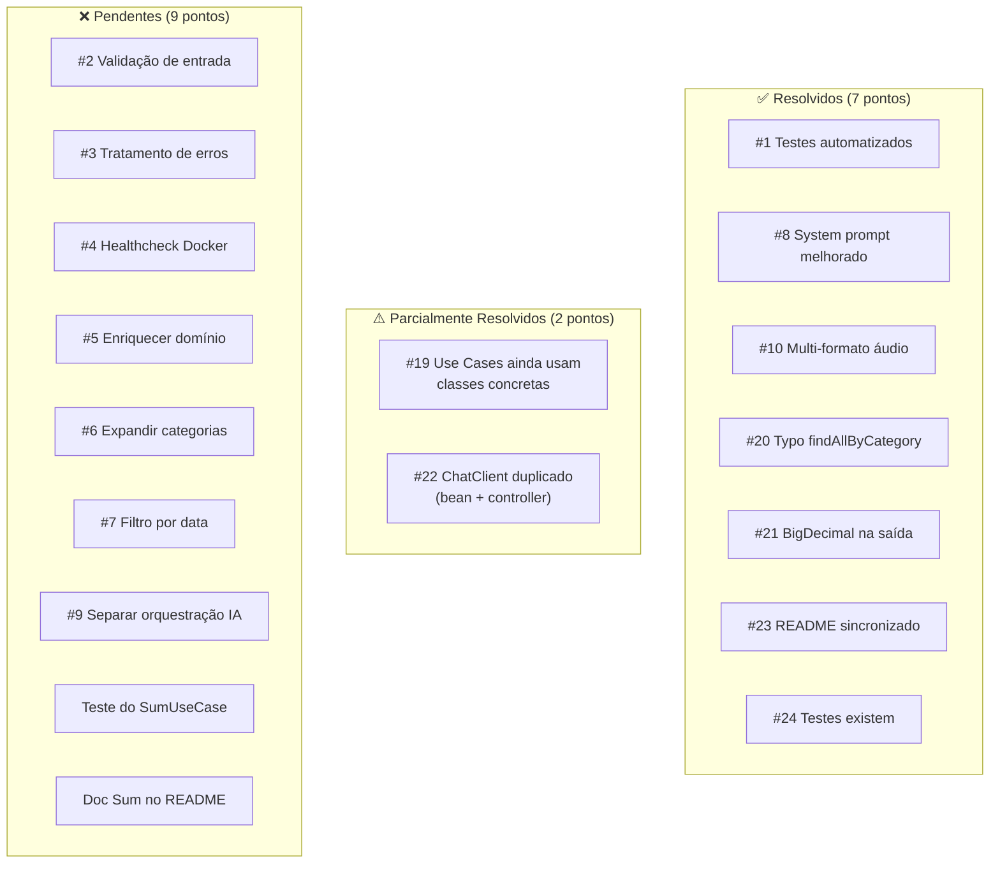

# 🔍 Análise do Projeto Budgeting — Sugestões de Melhoria

## Impressão Geral

O projeto está **muito bem estruturado**. A adoção de Arquitetura Hexagonal com separação clara entre `domain`, `application` e `infrastructure` é madura e demonstra bom domínio de princípios de design. O uso de records para DTOs, Value Objects (`TransactionId`), factory methods, e portas/adaptadores está coerente e idiomático para Java 21.

A integração multimodal (STT → Tool Calling → TTS) é criativa e funcional.

Dito isso, há bastante espaço para evoluir. Organizei as sugestões em **3 níveis de prioridade**:

---

## 🔴 Prioridade Alta — Problemas e Lacunas Críticas

### 1. ~~Ausência quase total de testes~~ ✅ RESOLVIDO

> [!NOTE]
> **Estado anterior:** O projeto tinha apenas o teste padrão `contextLoads()`.
>
> **O que foi implementado:** Agora existem **9 classes de teste** cobrindo todas as camadas:
> - **Domínio:** [`TransactionTest`](file:///c:/Users/gabri/IdeaProjects/ProjetoBudgetingItauEDio/src/test/java/br/com/ItauDIO/Budgeting/domain/TransactionTest.java) (5 testes — criação, ID pré-existente, todas as categorias, IDs únicos, valores limítrofes) e [`TransactionIdTest`](file:///c:/Users/gabri/IdeaProjects/ProjetoBudgetingItauEDio/src/test/java/br/com/ItauDIO/Budgeting/domain/TransactionIdTest.java) (3 testes — UUID gerado, distintos, preservação)
> - **Use Cases:** [`PersistTransactionUseCaseTest`](file:///c:/Users/gabri/IdeaProjects/ProjetoBudgetingItauEDio/src/test/java/br/com/ItauDIO/Budgeting/application/PersistTransactionUseCaseTest.java), [`ListTransactionsByCategoryUseCaseTest`](file:///c:/Users/gabri/IdeaProjects/ProjetoBudgetingItauEDio/src/test/java/br/com/ItauDIO/Budgeting/application/ListTransactionsByCategoryUseCaseTest.java), [`TranscribeAudioUseCaseTest`](file:///c:/Users/gabri/IdeaProjects/ProjetoBudgetingItauEDio/src/test/java/br/com/ItauDIO/Budgeting/application/TranscribeAudioUseCaseTest.java), [`SpeechSynthesizerUseCaseTest`](file:///c:/Users/gabri/IdeaProjects/ProjetoBudgetingItauEDio/src/test/java/br/com/ItauDIO/Budgeting/application/SpeechSynthesizerUseCaseTest.java) — todos com Mockito, verificando o caminho feliz e propagação de exceções.
> - **Infraestrutura:** [`TransactionControllerTest`](file:///c:/Users/gabri/IdeaProjects/ProjetoBudgetingItauEDio/src/test/java/br/com/ItauDIO/Budgeting/infrastructure/http/TransactionControllerTest.java) (4 testes — POST 201, GET por categoria, 400 para categoria inválida, fluxo de áudio completo), [`JpaTransactionRepositoryTest`](file:///c:/Users/gabri/IdeaProjects/ProjetoBudgetingItauEDio/src/test/java/br/com/ItauDIO/Budgeting/infrastructure/persistence/JpaTransactionRepositoryTest.java) (3 testes), [`TransactionEntityTest`](file:///c:/Users/gabri/IdeaProjects/ProjetoBudgetingItauEDio/src/test/java/br/com/ItauDIO/Budgeting/infrastructure/persistence/TransactionEntityTest.java) (1 teste — mapeamento bidirecional)
> - **Cobertura de código:** JaCoCo configurado no `pom.xml` para gerar relatórios.
>
> **O que ainda pode evoluir:**
> - Adicionar teste para o novo `SumTransactionsByCategoryUseCase` (único use case sem teste).
> - Adicionar teste do `sumAmountByCategory` no `JpaTransactionRepositoryTest`.
> - Considerar testes de integração com `@DataJpaTest` + H2 para validar a `@Query` JPQL do `sumAmountByCategory`.

### 2. Zero validação de entrada

Não há nenhuma validação em nenhuma camada:
- O `TransactionRequest` aceita `amount` negativo ou nulo silenciosamente.
- A `Transaction` não valida nada — podemos criar transações com descrição vazia e valor zero.
- O `PersistTransactionInput` aceita qualquer coisa.

> [!TIP]
> O teste [`TransactionTest.deveAceitarValoresLimitrofesSemValidacao()`](file:///c:/Users/gabri/IdeaProjects/ProjetoBudgetingItauEDio/src/test/java/br/com/ItauDIO/Budgeting/domain/TransactionTest.java#L68-L76) **documenta explicitamente** que valores zero e negativos são aceitos sem validação. Isso é bom como documentação do comportamento atual, mas reforça que a validação é uma pendência.

**Sugestões:**
- Adicionar validação no **domínio** (fail fast): `Transaction` deve lançar exceção para valores inválidos.
- Adicionar `@Valid` + Bean Validation (`@NotBlank`, `@NotNull`, `@Positive`) nos DTOs de request.
- Criar exceções de domínio próprias (`InvalidTransactionException`, etc.).

### 3. Tratamento de erros inexistente

- Não existe `@RestControllerAdvice` ou `@ExceptionHandler`.
- Se o áudio vier corrompido, se o Gemini estiver fora, se a categoria for inválida no path... o usuário receberá stack traces crus.

> [!NOTE]
> O `GeminiSpeechSynthesizer` agora lança `IllegalArgumentException` com mensagens descritivas em vez de `RuntimeException` genérica — uma melhoria pontual, mas a aplicação ainda carece de tratamento global.

**Sugestões:**
- Criar um `GlobalExceptionHandler` com `@RestControllerAdvice`.
- Definir exceções de domínio (`TransactionNotFoundException`, `InvalidCategoryException`, `AIServiceUnavailableException`).
- Retornar respostas padronizadas com `ProblemDetail` (RFC 7807, nativo do Spring Boot 4).

### 4. Healthcheck do Docker Compose inconsistente

O healthcheck usa `-uapp -papp`, mas as credenciais reais vêm do `.env` (`budget_user` / `budget_password`). Se o `.env` estiver correto, o healthcheck **sempre falha**.

---

## 🟡 Prioridade Média — Melhorias Arquiteturais e de Robustez

### 5. Enriquecer o domínio (`Transaction`)

A entidade `Transaction` é muito anêmica. Faltam informações essenciais para um sistema financeiro:

| Campo sugerido | Tipo | Justificativa |
|---|---|---|
| `createdAt` | `LocalDateTime` | Quando a transação ocorreu |
| `type` | `Enum (INCOME, EXPENSE)` | Distinguir receita de despesa |
| `notes` / `tags` | `String` / `List<String>` | Contexto adicional |

### 6. Expandir as categorias

Só existem 3 categorias (`GROCERIES`, `PHARMA`, `AUTO`). Um sistema financeiro real precisa de muito mais:

```
FOOD, TRANSPORT, HEALTH, EDUCATION, ENTERTAINMENT,
HOUSING, UTILITIES, CLOTHING, SALARY, INVESTMENTS, ...
```

**Opção mais flexível:** transformar `Category` em uma entidade própria com tabela no banco, permitindo que o usuário crie categorias customizadas.

### 7. Adicionar data/período nas consultas

O endpoint `GET /transactions/{category}` retorna **tudo** de uma categoria, sem filtro de data. Conforme os dados crescem, isso se torna inutilizável.

**Sugestão:** adicionar query params `?from=2026-01-01&to=2026-01-31` e/ou paginação (`?page=0&size=20`).

### 8. ~~O system prompt é muito raso~~ ✅ RESOLVIDO

> [!NOTE]
> **Estado anterior:** Prompt genérico de 3 linhas com typo e sem orientação sobre valores ou ferramentas.
>
> **O que foi implementado no** [`system-message.st`](file:///c:/Users/gabri/IdeaProjects/ProjetoBudgetingItauEDio/src/main/resources/prompts/system-message.st):
> - ✅ Typo corrigido ("extrais" → "extrair")
> - ✅ Ferramentas listadas explicitamente por nome (`Persist-transaction`, `List-transaction-by-category`, `Sum-transactions-by-category`) com descrição de quando usá-las
> - ✅ Instrução **detalhada sobre valores em centavos** — fundamental para a IA converter corretamente "R\$ 50" → `5000`
> - ✅ Clarificação de que listagem/soma devolvem valores já em reais
> - ✅ Definição de estilo de resposta para TTS: texto simples, sem markdown, sem emojis, curto e direto
> - ✅ Categorias disponíveis listadas com exemplos
>
> **O que ainda pode evoluir:**
> - Definir persona/nome do assistente
> - Instruir sobre como lidar com dados faltantes (ex: "gastei no mercado" sem valor)
> - Instruir para pedir confirmação quando houver ambiguidade

### 9. Separar a orquestração de IA do Controller

O `TransactionController.transcribe()` faz **transcrição + prompt IA + síntese de voz** tudo inline. Isso viola o SRP e a própria arquitetura hexagonal do projeto.

**Sugestão:** criar um `ProcessVoiceCommandUseCase` que orquestre todo o fluxo, deixando o controller apenas delegar.

### 10. ~~Adicionar suporte a mais formatos de áudio~~ ✅ RESOLVIDO

> [!NOTE]
> **Estado anterior:** O `GeminiAudioTranscriber` hardcodava `audio/wav`.
>
> **O que foi implementado:** O [`GeminiAudioTranscriber`](file:///c:/Users/gabri/IdeaProjects/ProjetoBudgetingItauEDio/src/main/java/br/com/ItauDIO/Budgeting/infrastructure/gemini/GeminiAudioTranscriber.java#L28-L29) agora usa `MediaTypeFactory.getMediaType(audio)` para detectar dinamicamente o MIME type do arquivo enviado, suportando WAV, MP3, OGG, WebM e qualquer formato reconhecido pelo Spring. Se o formato não for reconhecido, lança `IllegalArgumentException` com mensagem descritiva.

---

## 🟢 Prioridade Baixa — Evolução e Novas Features

### 11. Autenticação e multi-tenancy

O sistema não tem autenticação. Qualquer pessoa pode acessar qualquer transação. Para um sistema financeiro, isso é essencial.

**Sugestão:**
- Adicionar Spring Security com JWT ou OAuth2.
- Cada transação pertence a um `userId`.
- Filtrar queries por usuário autenticado.

### 12. Dashboard / Frontend

O sistema é apenas API. Um frontend enriqueceria muito a experiência:
- Dashboard com gráficos de gastos por categoria/mês.
- Upload de áudio pelo navegador.
- Histórico de interações com a IA.

### 13. Funcionalidades financeiras avançadas

- **Orçamento mensal por categoria:** "Quero gastar no máximo R\$500 em supermercado."
- **Alertas de limite:** Notificar quando estiver perto de estourar o orçamento.
- **Relatório mensal:** Resumo gerado pela IA com insights ("Você gastou 30% a mais em farmácia este mês").
- **Transações recorrentes:** Contas fixas como aluguel, streaming, etc.
- **Metas de economia:** "Quero juntar R\$5.000 até dezembro."

### 14. Chat por texto além de voz

Adicionar um endpoint `POST /transactions/ai/text` que aceite texto puro (JSON com `message`), sem precisar de áudio. Permite integração com chatbots, WhatsApp, Telegram, etc.

### 15. Histórico de conversas / memória contextual

Atualmente cada interação com a IA é stateless. O assistente não lembra do que foi dito antes.

**Sugestão:** usar `ChatMemory` do Spring AI para manter contexto da conversa por sessão, permitindo diálogos como:
> "Gastei 50 no mercado" → "Registrado!" → "E mais 30 na farmácia" → (IA entende o contexto)

### 16. Observabilidade e Logging

- Adicionar logging estruturado (SLF4J com Logback ou Log4j2).
- Logar: transcrições, prompts enviados, ferramentas acionadas, erros da API.
- Considerar Spring Boot Actuator para métricas e health endpoints.
- Tracing distribuído com Micrometer para rastrear o fluxo STT → IA → TTS.

### 17. Containerizar a aplicação

O `compose.yml` só tem o MySQL. Adicionar a própria aplicação como serviço Docker com multi-stage build tornaria o deploy muito mais simples e portável.

### 18. Documentação da API (OpenAPI / Swagger)

Adicionar `springdoc-openapi` para gerar documentação interativa automaticamente. Facilita para outros devs consumirem a API.

---

## 📊 Resumo Visual — Mapa de Prioridades


---

> [!TIP]
> Minha recomendação de **ordem de ataque**: comece pela validação e tratamento de erros (rápidos e de alto impacto), depois enriquecer o domínio com `createdAt` e mais categorias. O teste do `SumTransactionsByCategoryUseCase` é um quick win que fecha a cobertura dos use cases.

---

## ⚠️ Observações Adicionais do Código Real

Ao analisar o código-fonte real (que difere em alguns pontos do que o README descreve), identifiquei questões extras:

### 19. ~~Violação da Arquitetura Hexagonal nos Use Cases de STT/TTS~~ ⚠️ PARCIALMENTE RESOLVIDO

> [!NOTE]
> **O que mudou:** Os adaptadores [`GeminiAudioTranscriber`](file:///c:/Users/gabri/IdeaProjects/ProjetoBudgetingItauEDio/src/main/java/br/com/ItauDIO/Budgeting/infrastructure/gemini/GeminiAudioTranscriber.java#L16) e [`GeminiSpeechSynthesizer`](file:///c:/Users/gabri/IdeaProjects/ProjetoBudgetingItauEDio/src/main/java/br/com/ItauDIO/Budgeting/infrastructure/gemini/GeminiSpeechSynthesizer.java#L13) agora **implementam corretamente** as interfaces de porta `AudioTranscriber` e `SpeechSynthesizer` (com `@Override`).
>
> **O que NÃO mudou:** Os use cases [`TranscribeAudioUseCase`](file:///c:/Users/gabri/IdeaProjects/ProjetoBudgetingItauEDio/src/main/java/br/com/ItauDIO/Budgeting/application/TranscribeAudioUseCase.java#L3) e [`SpeechSynthesizerUseCase`](file:///c:/Users/gabri/IdeaProjects/ProjetoBudgetingItauEDio/src/main/java/br/com/ItauDIO/Budgeting/application/SpeechSynthesizerUseCase.java#L3) **ainda dependem diretamente das classes concretas** (`GeminiAudioTranscriber` e `GeminiSpeechSynthesizer`) em vez de usar as portas `AudioTranscriber` e `SpeechSynthesizer`. Funcionalmente não muda nada graças ao Spring DI, mas viola o princípio de inversão de dependência.
>
> Os testes também refletem essa dependência: `TranscribeAudioUseCaseTest` mocka `GeminiAudioTranscriber` em vez de `AudioTranscriber`.

### 20. ~~Typo no nome do método do repositório~~ ✅ RESOLVIDO

> [!NOTE]
> **Estado anterior:** O método se chamava `findALlByCategory` (com "L" maiúsculo).
>
> **O que foi implementado:** Agora é `findAllByCategory` — nome correto e consistente em todas as camadas: [`TransactionRepository`](file:///c:/Users/gabri/IdeaProjects/ProjetoBudgetingItauEDio/src/main/java/br/com/ItauDIO/Budgeting/domain/TransactionRepository.java#L7), [`TransactionEntityRepository`](file:///c:/Users/gabri/IdeaProjects/ProjetoBudgetingItauEDio/src/main/java/br/com/ItauDIO/Budgeting/infrastructure/persistence/repository/TransactionEntityRepository.java#L13), [`JpaTransactionRepository`](file:///c:/Users/gabri/IdeaProjects/ProjetoBudgetingItauEDio/src/main/java/br/com/ItauDIO/Budgeting/infrastructure/persistence/repository/JpaTransactionRepository.java#L26).

### 21. ~~Valor monetário armazenado como `long` (centavos) com saída em `double`~~ ✅ RESOLVIDO

> [!NOTE]
> **Estado anterior:** O `TransactionOutput` convertia o valor para `double`, reintroduzindo problemas de precisão.
>
> **O que foi implementado:**
> - [`TransactionOutput`](file:///c:/Users/gabri/IdeaProjects/ProjetoBudgetingItauEDio/src/main/java/br/com/ItauDIO/Budgeting/application/output/TransactionOutput.java#L8) agora usa `BigDecimal` com `setScale(2, RoundingMode.HALF_UP)` — sem perda de precisão.
> - [`CategoryTotalOutput`](file:///c:/Users/gabri/IdeaProjects/ProjetoBudgetingItauEDio/src/main/java/br/com/ItauDIO/Budgeting/application/output/CategoryTotalOutput.java#L8) (novo) também usa `BigDecimal` com mesma estratégia.
> - [`TransactionResponse`](file:///c:/Users/gabri/IdeaProjects/ProjetoBudgetingItauEDio/src/main/java/br/com/ItauDIO/Budgeting/infrastructure/http/response/TransactionResponse.java#L7) declara `BigDecimal amount`.
> - O system prompt instrui claramente que valores de persistência vão em centavos e saídas de consulta vêm em reais.

### 22. ~~Construção do `ChatClient` dentro do Controller~~ ⚠️ PARCIALMENTE RESOLVIDO

> [!NOTE]
> **O que mudou:** A [`BudgetingApplication`](file:///c:/Users/gabri/IdeaProjects/ProjetoBudgetingItauEDio/src/main/java/br/com/ItauDIO/Budgeting/BudgetingApplication.java#L11-L14) agora define um `@Bean ChatClient` na classe de configuração.
>
> **O que NÃO mudou:** O [`TransactionController`](file:///c:/Users/gabri/IdeaProjects/ProjetoBudgetingItauEDio/src/main/java/br/com/ItauDIO/Budgeting/infrastructure/http/TransactionController.java#L36-L43) **ainda constrói seu próprio `ChatClient`** no construtor com `chatClientBuilder.defaultSystem(...).defaultTools(...).build()`, ignorando o bean definido na `BudgetingApplication`. Existem efetivamente dois `ChatClient`: um no bean (não usado) e outro no controller (com as tools). Idealmente, a configuração completa (system prompt + tools) deveria estar em uma `@Configuration` separada e o controller receberia o `ChatClient` já pronto.

### 23. ~~README vs código real — dessincronização~~ ✅ RESOLVIDO

> [!NOTE]
> **O que foi implementado:** O README foi completamente reescrito e agora reflete o código real:
> - Valores em centavos (`long amount`) documentados corretamente
> - Ferramentas `Persist-transaction`, `List-transaction-by-category` e (parcialmente) `Sum-transactions-by-category` descritas
> - Seção de testes com `./mvnw test` — agora válida, pois os testes existem
> - Diagrama de sequência Mermaid atualizado
> - Estrutura de pastas coerente com o código
>
> **Ponto pendente no README:** A ferramenta `Sum-transactions-by-category` não aparece na tabela de rotas nem na seção de funcionalidades do README, apesar de ser uma tool disponível para a IA.

### 24. ~~Nenhum arquivo de teste existe~~ ✅ RESOLVIDO

> [!NOTE]
> Conforme detalhado no ponto 1, agora existem 9 classes de teste com boa cobertura de todas as camadas.

---

## 🆕 Nova Feature: Sum Transactions by Category (Tool Calling)

> [!IMPORTANT]
> Esta é a **nova ferramenta** adicionada desde a última análise.

### O que foi implementado

Uma nova tool de IA (`Sum-transactions-by-category`) que permite ao assistente responder perguntas como *"Quanto gastei em farmácia?"*:

- [`SumTransactionsByCategoryUseCase`](file:///c:/Users/gabri/IdeaProjects/ProjetoBudgetingItauEDio/src/main/java/br/com/ItauDIO/Budgeting/application/SumTransactionsByCategoryUseCase.java) — Use case com `@Tool` que soma todas as transações de uma categoria e retorna o total em reais via `CategoryTotalOutput`.
- [`CategoryTotalOutput`](file:///c:/Users/gabri/IdeaProjects/ProjetoBudgetingItauEDio/src/main/java/br/com/ItauDIO/Budgeting/application/output/CategoryTotalOutput.java) — DTO record que converte centavos → `BigDecimal` em reais.
- [`TransactionRepository.sumAmountByCategory()`](file:///c:/Users/gabri/IdeaProjects/ProjetoBudgetingItauEDio/src/main/java/br/com/ItauDIO/Budgeting/domain/TransactionRepository.java#L8) — Novo método na interface de domínio.
- [`TransactionEntityRepository.sumAmountByCategory()`](file:///c:/Users/gabri/IdeaProjects/ProjetoBudgetingItauEDio/src/main/java/br/com/ItauDIO/Budgeting/infrastructure/persistence/repository/TransactionEntityRepository.java#L15-L16) — Query JPQL `SELECT SUM(t.amount) FROM TransactionEntity t WHERE t.category = :category`.
- [`JpaTransactionRepository.sumAmountByCategory()`](file:///c:/Users/gabri/IdeaProjects/ProjetoBudgetingItauEDio/src/main/java/br/com/ItauDIO/Budgeting/infrastructure/persistence/repository/JpaTransactionRepository.java#L32-L36) — Adapter que trata `null` → `0L` (quando não há transações na categoria).
- Registrada como default tool no [`TransactionController`](file:///c:/Users/gabri/IdeaProjects/ProjetoBudgetingItauEDio/src/main/java/br/com/ItauDIO/Budgeting/infrastructure/http/TransactionController.java#L42).

### Qualidade da implementação

| Aspecto | Avaliação |
|---|---|
| Arquitetura Hexagonal | ✅ Segue o padrão — porta no domínio, adapter na infra |
| BigDecimal | ✅ Conversão correta centavos → reais |
| Null safety | ✅ Trata `null` do `SUM()` SQL corretamente |
| System Prompt | ✅ Tool documentada com orientação de quando usá-la |
| Testes | ❌ **Não há teste unitário** para este use case |
| README | ⚠️ Tool não documentada na tabela de endpoints/funcionalidades |

### Sugestões para a nova feature

1. **Criar `SumTransactionsByCategoryUseCaseTest`** — mockar o repositório e testar: cenário com valor, cenário com zero (categoria sem transações), propagação de exceção.
2. **Adicionar teste de integração** para a query JPQL `sumAmountByCategory` com `@DataJpaTest`.
3. **Documentar no README** na seção de funcionalidades e no diagrama de sequência.

---

## 🔄 Outras Mudanças Identificadas nesta Revisão

### Refatoração da camada de persistência

> [!NOTE]
> A camada de persistência foi reorganizada:
> - **Antes:** `TransactionMySQLRepository` (Spring Data) + `TransactionRepositoryAdapter`
> - **Agora:** [`TransactionEntityRepository`](file:///c:/Users/gabri/IdeaProjects/ProjetoBudgetingItauEDio/src/main/java/br/com/ItauDIO/Budgeting/infrastructure/persistence/repository/TransactionEntityRepository.java) (Spring Data `CrudRepository`) + [`JpaTransactionRepository`](file:///c:/Users/gabri/IdeaProjects/ProjetoBudgetingItauEDio/src/main/java/br/com/ItauDIO/Budgeting/infrastructure/persistence/repository/JpaTransactionRepository.java) (adapter implementando `TransactionRepository`)
>
> A nomenclatura ficou mais clara e idiomática. O `TransactionEntityRepository` lida apenas com a entidade JPA, enquanto o `JpaTransactionRepository` faz a tradução domínio ↔ entidade.

### ChatClient Bean na BudgetingApplication

Foi adicionado um `@Bean ChatClient chatChatClient(ChatClient.Builder builder)` na [`BudgetingApplication`](file:///c:/Users/gabri/IdeaProjects/ProjetoBudgetingItauEDio/src/main/java/br/com/ItauDIO/Budgeting/BudgetingApplication.java#L11-L14). No entanto, conforme mencionado no ponto 22, este bean não está sendo usado pelo controller.

### SpeechOutput como record dedicado

O [`SpeechOutput`](file:///c:/Users/gabri/IdeaProjects/ProjetoBudgetingItauEDio/src/main/java/br/com/ItauDIO/Budgeting/application/output/SpeechOutput.java) agora é um record com `byte[] audio` e `String mimeType`, melhorando a tipagem da saída do sintetizador de voz.

### SpeechSynthesizer com interface renomeada

A interface [`SpeechSynthesizer`](file:///c:/Users/gabri/IdeaProjects/ProjetoBudgetingItauEDio/src/main/java/br/com/ItauDIO/Budgeting/application/port/SpeechSynthesizer.java) agora retorna `SpeechOutput` em vez de `SpeechSynthesizerOutput`, e o método foi renomeado para usar `texto` como parâmetro — mais consistente.

### Dependências de teste no pom.xml

Foram adicionadas dependências de teste específicas:
- `spring-boot-starter-webmvc-test` (scope test)
- `spring-boot-starter-data-jpa-test` (scope test)
- `jacoco-maven-plugin` 0.8.12 para cobertura de código

---

## 📊 Resumo de Progresso



---

Me diga quais pontos te interessam mais e quais são as **suas ideias** de melhoria — posso te ajudar a priorizar e depois partir para a implementação! 🚀
