# 🔍 Análise do Projeto Budgeting — Sugestões de Melhoria

## Impressão Geral

O projeto está **muito bem estruturado**. A adoção de Arquitetura Hexagonal com separação clara entre `domain`, `application` e `infrastructure` é madura e demonstra bom domínio de princípios de design. O uso de records para DTOs, Value Objects (`TransactionId`), factory methods (`Transaction.create` / `reconstitute`), e portas/adaptadores está coerente e idiomático para Java 21.

A integração multimodal (STT → Tool Calling → TTS) é criativa e funcional.

Dito isso, há bastante espaço para evoluir. Organizei as sugestões em **3 níveis de prioridade**:

---

## 🔴 Prioridade Alta — Problemas e Lacunas Críticas

### 1. Ausência quase total de testes

O projeto tem apenas o teste padrão `contextLoads()`. Para um sistema que lida com **dinheiro** e usa **IA com decisões autônomas**, isso é arriscado.

**Sugestões:**
- **Testes unitários do domínio:** Validar `Transaction.create()` com valores negativos, nulos, descrição vazia.
- **Testes dos Use Cases:** Mockar o repositório e verificar se os `@Tool` retornam o esperado.
- **Testes de integração do Controller:** Usar `@WebMvcTest` para testar os endpoints REST (JSON e multipart).
- **Testes do adaptador de persistência:** Usar `@DataJpaTest` com H2 ou Testcontainers.

### 2. Zero validação de entrada

Não há nenhuma validação em nenhuma camada:
- O `TransactionRequest` aceita `amount` negativo ou nulo silenciosamente.
- A `Transaction.create()` não valida nada — podemos criar transações com descrição vazia e valor zero.
- O `PersistTransactionInput` aceita qualquer coisa.

**Sugestões:**
- Adicionar validação no **domínio** (fail fast): `Transaction.create()` deve lançar exceção para valores inválidos.
- Adicionar `@Valid` + Bean Validation (`@NotBlank`, `@NotNull`, `@Positive`) nos DTOs de request.
- Criar exceções de domínio próprias (`InvalidTransactionException`, etc.).

### 3. Tratamento de erros inexistente

- O `GeminiSpeechSynthesizerAdapter` lança `RuntimeException` genérica.
- Não existe `@RestControllerAdvice` ou `@ExceptionHandler`.
- Se o áudio vier corrompido, se o Gemini estiver fora, se a categoria for inválida no path... o usuário receberá stack traces crus.

**Sugestões:**
- Criar um `GlobalExceptionHandler` com `@RestControllerAdvice`.
- Definir exceções de domínio (`TransactionNotFoundException`, `InvalidCategoryException`, `AIServiceUnavailableException`).
- Retornar respostas padronizadas com `ProblemDetail` (RFC 7807, nativo do Spring Boot 4).

### 4. Healthcheck do Docker Compose inconsistente

O healthcheck usa `-uapp -papp`, mas as credenciais reais vêm do `.env` (`budget_user` / `budget_password`). Se o `.env` estiver correto, o healthcheck **sempre falha**.

---

## 🟡 Prioridade Média — Melhorias Arquiteturais e de Robustez

### 5. Enriquecer o domínio (`Transaction`)

A entidade `Transaction` é muito anêmica. Faltam informações essenciais para um sistema financeiro:

| Campo sugerido | Tipo | Justificativa |
|---|---|---|
| `createdAt` | `LocalDateTime` | Quando a transação ocorreu |
| `type` | `Enum (INCOME, EXPENSE)` | Distinguir receita de despesa |
| `notes` / `tags` | `String` / `List<String>` | Contexto adicional |

### 6. Expandir as categorias

Só existem 3 categorias (`GROCERIES`, `PHARMA`, `AUTO`). Um sistema financeiro real precisa de muito mais:

```
FOOD, TRANSPORT, HEALTH, EDUCATION, ENTERTAINMENT,
HOUSING, UTILITIES, CLOTHING, SALARY, INVESTMENTS, ...
```

**Opção mais flexível:** transformar `Category` em uma entidade própria com tabela no banco, permitindo que o usuário crie categorias customizadas.

### 7. Adicionar data/período nas consultas

O endpoint `GET /transactions/{category}` retorna **tudo** de uma categoria, sem filtro de data. Conforme os dados crescem, isso se torna inutilizável.

**Sugestão:** adicionar query params `?from=2026-01-01&to=2026-01-31` e/ou paginação (`?page=0&size=20`).

### 8. O system prompt é muito raso

O prompt atual:
```
Você é um assistente financeiro.
Sua tarefa é extrais dados de transações e usar ferramentas disponíveis para manipular transações.
Ao registrar uma transação, escolha a categoria que melhor se adapta ao contexto.
```

**Problemas:**
- Typo: "extrais" → "extrair".
- Não orienta sobre como lidar com ambiguidade (ex: "gastei no iFood" → é `GROCERIES` ou `FOOD`?).
- Não define tom/personalidade.
- Não instrui sobre o que fazer quando dados estão incompletos (valor não mencionado, por exemplo).

**Sugestão de prompt mais robusto:**
- Definir persona e tom (formal/casual, nome do assistente).
- Listar categorias disponíveis com exemplos de mapeamento.
- Instruir para pedir confirmação quando houver ambiguidade.
- Definir como lidar com dados faltantes.

### 9. Separar a orquestração de IA do Controller

O `TransactionController.createTransactionWithAI()` faz **transcrição + prompt IA + síntese de voz** tudo inline. Isso viola o SRP e a própria arquitetura hexagonal do projeto.

**Sugestão:** criar um `ProcessVoiceCommandUseCase` que orquestre todo o fluxo, deixando o controller apenas delegar.

### 10. Adicionar suporte a mais formatos de áudio

O `GeminiAudioTranscriberAdapter` hardcoda `audio/wav`. Se o usuário enviar MP3, OGG, ou WebM (comum em apps mobile), vai falhar.

**Sugestão:** detectar o MIME type do arquivo enviado (`file.getContentType()`) e passar dinamicamente.

---

## 🟢 Prioridade Baixa — Evolução e Novas Features

### 11. Autenticação e multi-tenancy

O sistema não tem autenticação. Qualquer pessoa pode acessar qualquer transação. Para um sistema financeiro, isso é essencial.

**Sugestão:**
- Adicionar Spring Security com JWT ou OAuth2.
- Cada transação pertence a um `userId`.
- Filtrar queries por usuário autenticado.

### 12. Dashboard / Frontend

O sistema é apenas API. Um frontend enriqueceria muito a experiência:
- Dashboard com gráficos de gastos por categoria/mês.
- Upload de áudio pelo navegador.
- Histórico de interações com a IA.

### 13. Funcionalidades financeiras avançadas

- **Orçamento mensal por categoria:** "Quero gastar no máximo R\$500 em supermercado."
- **Alertas de limite:** Notificar quando estiver perto de estourar o orçamento.
- **Relatório mensal:** Resumo gerado pela IA com insights ("Você gastou 30% a mais em farmácia este mês").
- **Transações recorrentes:** Contas fixas como aluguel, streaming, etc.
- **Metas de economia:** "Quero juntar R\$5.000 até dezembro."

### 14. Chat por texto além de voz

Adicionar um endpoint `POST /transactions/ai/text` que aceite texto puro (JSON com `message`), sem precisar de áudio. Permite integração com chatbots, WhatsApp, Telegram, etc.

### 15. Histórico de conversas / memória contextual

Atualmente cada interação com a IA é stateless. O assistente não lembra do que foi dito antes.

**Sugestão:** usar `ChatMemory` do Spring AI para manter contexto da conversa por sessão, permitindo diálogos como:
> "Gastei 50 no mercado" → "Registrado!" → "E mais 30 na farmácia" → (IA entende o contexto)

### 16. Observabilidade e Logging

- Adicionar logging estruturado (SLF4J com Logback ou Log4j2).
- Logar: transcrições, prompts enviados, ferramentas acionadas, erros da API.
- Considerar Spring Boot Actuator para métricas e health endpoints.
- Tracing distribuído com Micrometer para rastrear o fluxo STT → IA → TTS.

### 17. Containerizar a aplicação

O `compose.yml` só tem o MySQL. Adicionar a própria aplicação como serviço Docker com multi-stage build tornaria o deploy muito mais simples e portável.

### 18. Documentação da API (OpenAPI / Swagger)

Adicionar `springdoc-openapi` para gerar documentação interativa automaticamente. Facilita para outros devs consumirem a API.

---

## 📊 Resumo Visual — Mapa de Prioridades

```mermaid
flowchart LR
    subgraph ALTA["🔴 Alta Prioridade"]
        A1["Testes automatizados"]
        A2["Validação de entrada"]
        A3["Tratamento de erros"]
        A4["Fix healthcheck Docker"]
    end

    subgraph MEDIA["🟡 Média Prioridade"]
        B1["Enriquecer domínio\n(data, tipo, tags)"]
        B2["Expandir categorias"]
        B3["Filtro por data + paginação"]
        B4["Melhorar system prompt"]
        B5["Separar orquestração IA\ndo Controller"]
        B6["Suporte multi-formato áudio"]
    end

    subgraph BAIXA["🟢 Evolução"]
        C1["Autenticação + multi-user"]
        C2["Frontend / Dashboard"]
        C3["Orçamento, alertas, metas"]
        C4["Chat texto + integração"]
        C5["Memória contextual"]
        C6["Observabilidade"]
        C7["Dockerizar app"]
        C8["OpenAPI / Swagger"]
    end

    ALTA --> MEDIA --> BAIXA
```



---

> [!TIP]
> Minha recomendação de **ordem de ataque**: comece pela validação e tratamento de erros (rápidos e de alto impacto), depois testes, e na sequência enriquecer o domínio com `createdAt` e mais categorias. Isso dá uma base sólida para qualquer feature nova.

---

## ⚠️ Observações Adicionais do Código Real

Ao analisar o código-fonte real (que difere em alguns pontos do que o README descreve), identifiquei questões extras:

### 19. Violação da Arquitetura Hexagonal nos Use Cases de STT/TTS

Os use cases `TranscribeAudioUseCase` e `SpeechSynthesizerUseCase` **dependem diretamente das classes concretas de infraestrutura** (`GeminiAudioTranscriber` e `GeminiSpeechSynthesizer`), em vez de usar as portas/interfaces (`AudioTranscriber` e `SpeechSynthesizer`). As interfaces existem, mas não estão sendo usadas nesses use cases — um detalhe que quebra a inversão de dependência.

### 20. Typo no nome do método do repositório

O método `findALlByCategory` (com "L" maiúsculo) aparece tanto na interface de domínio quanto no adapter. Funciona porque o Spring Data faz query derivation, mas é inconsistente e confuso para outros devs.

### 21. Valor monetário armazenado como `long` (centavos)

O domínio usa `long amount` (centavos), o que é uma decisão válida para evitar arredondamento, mas:
- O `TransactionOutput` converte para `double` — que **reintroduz** o problema de precisão.
- O `@ToolParam` diz "Valor de uma transação (em centavos)" — a IA precisa converter "50 reais" para `5000`. Isso funciona de forma confiável?
- Considerar usar `BigDecimal` na saída, ou pelo menos documentar claramente a convenção.

### 22. Construção do `ChatClient` dentro do Controller

No construtor do `TransactionController`, o `ChatClient` é criado com `chatClientBuilder.defaultSystem(...).defaultTools(...).build()`. Isso mistura configuração de IA com responsabilidade do controller. Idealmente, isso deveria estar na `BudgetingApplication` (ou em uma `@Configuration` separada), e o controller receberia o `ChatClient` já configurado.

### 23. README vs código real — dessincronização

O README mostra uso de `BigDecimal`, `Transaction.create()`, `Transaction.reconstitute()`, e portas nos use cases — mas o código real usa `long amount`, construtores diretos, e classes concretas. Manter o README sincronizado é essencial para credibilidade do projeto.

### 24. Nenhum arquivo de teste existe

Diferente do que o README sugere com o comando `./mvnw test`, não existe nenhum arquivo de teste no projeto. Nem mesmo o `contextLoads()`.

---

Me diga quais pontos te interessam mais e quais são as **suas ideias** de melhoria — posso te ajudar a priorizar e depois partir para a implementação! 🚀
