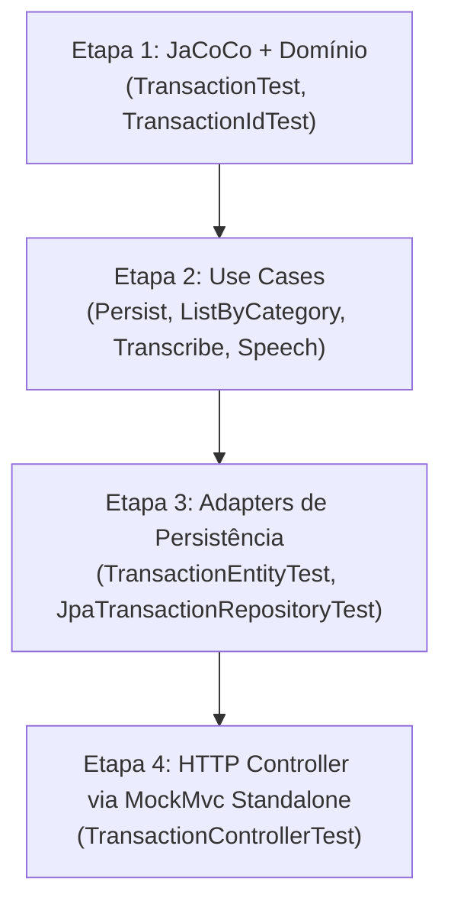

# 🧪 Plano de Implementação — Testes Unitários (JUnit 5 + Mockito)

> **Projeto:** Budgeting  
> **Prioridade:** 🔴 Alta — Tópico 1  
> **Escopo:** Testes unitários das camadas Domain, Application, Infrastructure (Persistence) e HTTP Controller.

---

## 🚫 Fora do Escopo, Restrições & Regra de Parada

- **Sem chamadas a banco real ou containers:** nenhum container Docker/MySQL subirá; operações de persistência e interfaces serão mockadas ou testadas em memória como POJOs.
- **Sem chamadas reais a APIs externas (Google Gemini):** STT, TTS e ChatClient serão mockados para execução 100% offline, determinística e veloz.
- **Sem testes de integração completos (`@SpringBootTest` com contexto real):** restrito a testes unitários rápidos.
- **Comparação de arrays de bytes:** é obrigatório o uso de `assertArrayEquals(expected, actual)` em todas as asserções de `byte[]`.
- ⚠️ **REGRA CRÍTICA DE INTEGRIDADE DO CÓDIGO:**
  - O código-fonte de produção em `src/main` **NÃO DEVE SER ALTERADO** nesta etapa.
  - Se durante a implementação qualquer teste evidenciar um bug ou incompatibilidade que pareça exigir edição em `src/main`, **PARE IMEDIATAMENTE E AVISE O USUÁRIO**.
  - **NUNCA altere ou enfraqueça as asserções de um teste apenas para fazê-lo passar**.

---

## ⚙️ Configuração Inicial: Cobertura com JaCoCo

Adicionar o plugin **JaCoCo** ao [pom.xml](file:///c:/Users/gabri/IdeaProjects/Budgeting/pom.xml).

> [!NOTE]
> **Decisão sobre Meta de Cobertura:** Nesta etapa, o JaCoCo será configurado para **apenas medição e geração de relatório** (`prepare-agent` e `report`), sem impor `<check>` com quebra de build (`haltOnFailure`). O objetivo é estabelecer a métrica base e permitir inspeção visual em `target/site/jacoco/index.html` (com meta indicativa referencial de ≥ 80% em `domain` e `application`).

```xml
<plugin>
    <groupId>org.jacoco</groupId>
    <artifactId>jacoco-maven-plugin</artifactId>
    <version>0.8.12</version>
    <executions>
        <execution>
            <goals>
                <goal>prepare-agent</goal>
            </goals>
        </execution>
        <execution>
            <id>report</id>
            <phase>test</phase>
            <goals>
                <goal>report</goal>
            </goals>
        </execution>
    </executions>
</plugin>
```

---

## 🗺️ Ordem Unificada de Execução (4 Etapas Independentes)

Cada etapa é independente, compilável e commitável isoladamente.



---

## 📦 Etapa 1: Configuração do JaCoCo & Testes de Domínio

**Foco:** Testes lógicos puros sem mocks para entidades e Value Objects.  
**Commit sugerido:** `test(domain): add unit tests for Transaction and TransactionId and configure JaCoCo`

### 1.1 `TransactionIdTest` (2 testes)
1. **`deveGerarUUIDValidoPorPadrao`:** instancia com construtor padrão e valida que `id()` não é nulo.
2. **`devePreservarUUIDFornecido`:** instancia com UUID conhecido e valida preservação de valor e igualdade de record (`equals`/`hashCode`).

### 1.2 `TransactionTest` (4 testes)
3. **`deveCriarTransacaoComCamposCorretos`:** instancia via construtor `(description, amount, category)` e checa todos os getters e geração automática do `TransactionId`.
4. **`devePermitirInstanciacaoComIdExistente`:** valida construtor completo com `TransactionId` pré-definido.
5. **`devePermitirCriacaoComTodasAsCategorias`:** `@ParameterizedTest` com `@EnumSource(Category.class)` cobrindo `GROCERIES`, `PHARMA` e `AUTO`.
6. **`deveAceitarValoresLimítrofesSemValidacao`:** documenta comportamento atual sem validação (permite `amount = 0` e valores negativos, para tratamento posterior no plano de validação).

---

## 📦 Etapa 2: Testes da Camada de Aplicação (Use Cases)

**Foco:** Casos de uso com `@ExtendWith(MockitoExtension.class)`, cobrindo cenários felizes e cenários de exceção para cada use case. Uso de `assertArrayEquals` para retornos binários.  
**Commit sugerido:** `test(application): add unit tests for all transaction and ai use cases`

### 2.1 `PersistTransactionUseCaseTest` (2 testes)
7. **Sucesso — `devePersistirTransacaoERetornarOutputMapeado`:**
   - Mock: `transactionRepository.save(any(Transaction.class))` retornando transação mockada.
   - Ação: chama `execute(new PersistTransactionInput("Mercado", Category.GROCERIES, 5000L))`.
   - Asserções agrupadas: captura a transação salva (`ArgumentCaptor`), verifica se os dados bateram com o input e valida todos os campos do `TransactionOutput` (`id`, `description`, `category="GROCERIES"`, `value=50.0`).
8. **Erro — `devePropagarExcecaoQuandoRepositorioFalhar`:**
   - Mock: `transactionRepository.save(...)` lança `RuntimeException`.
   - Ação: `assertThrows` garantindo que a exceção é propagada.

### 2.2 `ListTransactionsByCategoryUseCaseTest` (3 testes)
9. **Sucesso — `deveRetornarListaDeTransacoesMapeadas`:**
   - Mock: `transactionRepository.findALlByCategory(Category.PHARMA)` (*nome real*) retornando 2 transações.
   - Asserções agrupadas: valida tamanho da lista e todos os campos dos `TransactionOutput`.
10. **Sucesso (Vazio) — `deveRetornarListaVaziaQuandoNaoHouverRegistros`:**
    - Mock: `findALlByCategory` retorna `List.of()`. Valida retorno vazio sem falhas.
11. **Erro — `devePropagarExcecaoQuandoConsultaFalhar`:**
    - Mock: `findALlByCategory` lança exceção em falha. Valida propagação via `assertThrows`.

### 2.3 `TranscribeAudioUseCaseTest` (2 testes)
12. **Sucesso — `deveTranscreverAudioComSucesso`:**
    - Mock: `GeminiAudioTranscriber.transcribe(any(Resource.class))` retornando `"Gastei 20 reais"`.
    - Asserção: texto retornado confere com o retornado pelo adaptador.
13. **Erro — `devePropagarExcecaoQuandoFalharTranscricao`:**
    - Mock: `transcribe(...)` lança `IllegalArgumentException`. Valida lançamento com `assertThrows`.

### 2.4 `SpeechSynthesizerUseCaseTest` (2 testes)
14. **Sucesso — `deveSintetizarTextoEmAudio`:**
    - Mock: `GeminiSpeechSynthesizer.synthesize("Texto")` retornando `new SpeechOutput(new byte[]{1, 2, 3}, "audio/wav")`.
    - Asserção: valida array de bytes retornado usando mandatoriamente `assertArrayEquals(new byte[]{1, 2, 3}, result)`.
15. **Erro — `devePropagarExcecaoQuandoGeminiFalharSintese`:**
    - Mock: `synthesize(...)` lança `IllegalArgumentException` ("O gemini não devolveu áudio.").
    - Asserção: `assertThrows` validando o erro.

---

## 📦 Etapa 3: Testes dos Adaptadores de Persistência

**Foco:** Mapeamento bidirecional e isolamento das chamadas com Mockito puro.  
**Commit sugerido:** `test(infrastructure): add unit tests for TransactionEntity and JpaTransactionRepository`

### 3.1 `TransactionEntityTest` (1 teste)
16. **`deveGarantirMapeamentoBidirecionalEntreDominioEEntity`:**
    - Cria `Transaction` → converte via `TransactionEntity.from(...)` → reconverte via `entity.toDomain()`.
    - Valida que `id`, `description`, `amount` e `category` permanecem idênticos em todo o ciclo.

### 3.2 `JpaTransactionRepositoryTest` (3 testes)
17. **`deveSalvarTransacaoMapeandoParaEntity`:**
    - Mock: `TransactionEntityRepository.save(any(TransactionEntity.class))` devolve entity persistida.
    - Asserções agrupadas: captura entity, valida atributos mapeados e confere a `Transaction` de domínio retornada.
18. **`deveBuscarTodasPorCategoriaEReconverterParaDominio`:**
    - Mock: `transactionEntityRepository.findAllByCategory(Category.AUTO)` devolve entities.
    - Ação: chama `jpaTransactionRepository.findALlByCategory(Category.AUTO)`. Valida lista de domínio reconvertida.
19. **`devePropagarExcecaoQuandoEntityRepositoryFalhar`:**
    - Mock: repositório lança exceção. Valida propagação com `assertThrows`.

---

## 📦 Etapa 4: Testes do Controller HTTP (MockMvc Standalone)

**Foco:** Testar rotas, contratos HTTP, códigos de status (inclusive 400 Bad Request para enums inválidos) e headers sem subir contexto Spring.  
**Commit sugerido:** `test(http): add standalone MockMvc tests for TransactionController`

### Inspeção Real do Código de Produção ([TransactionController.java](file:///c:/Users/gabri/IdeaProjects/Budgeting/src/main/java/br/com/ItauDIO/Budgeting/infrastructure/http/TransactionController.java)):
- Construtor executa:
  `this.chatClient = chatClientBuilder.defaultSystem(systemPrompt.getContentAsString(...)).defaultTools(persistTransactionUseCase, listTransactionsByCategoryUseCase).build();`
  -> `defaultTools` recebe varargs `Object... tools` (2 argumentos no código: `persistTransactionUseCase`, `listTransactionsByCategoryUseCase`).
- Método `/ai` executa:
  `String text = transcribeAudioUseCase.transcribe(file.getResource());`
  `var result = chatClient.prompt().user(text).call().content();`
  `byte[] audio = speechSynthesizerUseCase.synthesize(result);`
  Parâmetro multipart: `@RequestParam("file") MultipartFile file`.

### Configuração do Teste:
```java
@ExtendWith(MockitoExtension.class)
class TransactionControllerTest {

    private MockMvc mockMvc;

    @Mock private PersistTransactionUseCase persistTransactionUseCase;
    @Mock private ListTransactionsByCategoryUseCase listTransactionsByCategoryUseCase;
    @Mock private TranscribeAudioUseCase transcribeAudioUseCase;
    @Mock private SpeechSynthesizerUseCase speechSynthesizerUseCase;

    @Mock(answer = Answers.RETURNS_DEEP_STUBS)
    private ChatClient.Builder chatClientBuilder;

    @Mock(answer = Answers.RETURNS_DEEP_STUBS)
    private ChatClient chatClient;

    @Mock private Resource systemPromptResource;

    @BeforeEach
    void setUp() throws IOException {
        when(systemPromptResource.getContentAsString(any(Charset.class))).thenReturn("Prompt Mock");
        when(chatClientBuilder.defaultSystem(anyString()).defaultTools(any(), any()).build()).thenReturn(chatClient);

        TransactionController controller = new TransactionController(
                persistTransactionUseCase,
                listTransactionsByCategoryUseCase,
                transcribeAudioUseCase,
                systemPromptResource,
                chatClientBuilder,
                speechSynthesizerUseCase
        );

        this.mockMvc = MockMvcBuilders.standaloneSetup(controller).build();
    }
}
```

### Casos de Teste (4 testes):
20. **`deveCriarTransacaoERetornar201Created`:**
    - `POST /transactions` com JSON `{"description":"Lanche","category":"GROCERIES","amount":3500}`.
    - Mock: `persistTransactionUseCase.execute(any())` -> `new TransactionOutput("uuid-1", "Lanche", "GROCERIES", 35.0)`.
    - Asserções: `status().isCreated()`, JSON fields `id`, `description`, `category`, `amount`.
21. **`deveListarTransacoesPorCategoriaERetornar200Ok`:**
    - `GET /transactions/GROCERIES`.
    - Mock: `listTransactionsByCategoryUseCase.execute(Category.GROCERIES)` -> lista populada.
    - Asserções: `status().isOk()`, JSON array populado.
22. **`deveRetornar400BadRequestQuandoCategoriaForInvalida`:**
    - `GET /transactions/CATEGORIA_INEXISTENTE`.
    - Asserções: `status().isBadRequest()` (validação de binding do Spring MVC na conversão do enum do path variable).
23. **`deveProcessarAudioComIAERetornarAudioWav`:**
    - `POST /transactions/ai` com `MockMultipartFile("file", "teste.wav", "audio/wav", new byte[]{1, 2, 3})`.
    - Mocking profundo com stubs:
      - `transcribeAudioUseCase.transcribe(any())` -> `"Gastei 50"`
      - `chatClient.prompt().user("Gastei 50").call().content()` -> `"Despesa anotada"`
      - `speechSynthesizerUseCase.synthesize("Despesa anotada")` -> `new byte[]{4, 5, 6}`
    - Asserções: `status().isOk()`, `header().string("Content-Type", "audio/wav")`, e validação do corpo retornado via `assertArrayEquals(new byte[]{4, 5, 6}, result.getResponse().getContentAsByteArray())`.

---

## 📊 Resumo Exato de Testes

| Etapa | Classes de Teste | Qtd Testes | Foco |
|---|---|---|---|
| **Etapa 1** | `TransactionIdTest`<br>`TransactionTest` | 2<br>4 | Value Object & Domínio (total: 6) |
| **Etapa 2** | `PersistTransactionUseCaseTest`<br>`ListTransactionsByCategoryUseCaseTest`<br>`TranscribeAudioUseCaseTest`<br>`SpeechSynthesizerUseCaseTest` | 2<br>3<br>2<br>2 | Regras de aplicação, mocks de stubs e cenários de exceção (total: 9) |
| **Etapa 3** | `TransactionEntityTest`<br>`JpaTransactionRepositoryTest` | 1<br>3 | Conversão de entity e delegação JPA (total: 4) |
| **Etapa 4** | `TransactionControllerTest` | 4 | MockMvc standalone, 201/200/400, multipart e audio/wav (total: 4) |
| **Total Geral** | **7 classes** | **23 testes** | **100% unitários, sem mocks vazios e sem duplicações** |

---

## ✅ Critérios de Aceite da Tarefa

- [ ] JaCoCo configurado no `pom.xml` para medição.
- [ ] Todas as 4 etapas implementadas e compilando com `./mvnw test-compile`.
- [ ] Execução de `./mvnw test` completando com **23 testes passando e 0 falhas**.
- [ ] Relatório JaCoCo gerado com sucesso em `target/site/jacoco/index.html`.
- [ ] **0 alterações realizadas no código de produção em `src/main`**.
